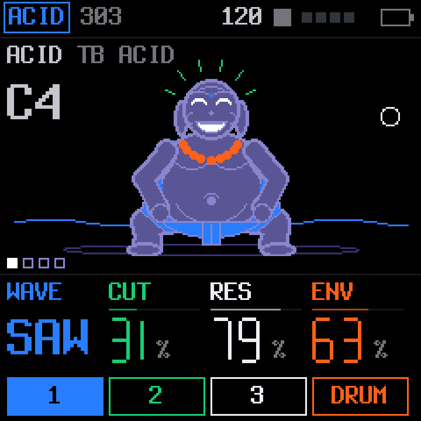

<h1 align="center">KARMA</h1>

<b>Free, open-source firmware for the M-VAVE FM-1.</b> 
Four tracks, a drum synth, a 64-step sequencer, generators that keep writing while you play, and a cast of pixel characters.

<a href="https://eatyourgreensstudio-dotcom.github.io/karma-fm1/"><b>Website</b></a> ·
<a href="https://eatyourgreensstudio-dotcom.github.io/karma-fm1/emu/"><b>Try it in the browser</b></a> ·
<a href="https://eatyourgreensstudio-dotcom.github.io/karma-fm1/webapp/installer/"><b>Install</b></a> ·
<a href="https://eatyourgreensstudio-dotcom.github.io/karma-fm1/webapp/editor/">Web editor</a> ·
<a href="GUIDE.md">Guide</a> ·
<a href="../../issues">Report a bug</a>

---

> **Status:** 3.0, running on a real FM-1. Install it from the browser with the [web installer](https://eatyourgreensstudio-dotcom.github.io/karma-fm1/webapp/installer/)
> (Chrome or Edge, a USB data cable); the same page puts the official firmware back. Never for sale, free forever.

## What's inside

- **Track 1: ACID or JUNO.** A TB-303 voice (from X0X) or a Juno-106 style polysynth (from FM-106).
- **Track 2: ELEMENTS.** Physical modelling built on Mutable Instruments' open-source Elements code: strike, pluck, bow or blow a modal resonator; the Ominous Voice.
- **Track 3: PLAITS.** 24 synthesis models built on Mutable Instruments' open-source Plaits code.
- **Drums: HEX.** The drum voices of the open-source LXR-02 firmware by Erica Synths, ported: five kits and four of your own, synthesised (no samples but its short transient clicks).
- **Sequencer.** 64 steps a track, chords of up to 4 notes, ratchets, accents, slides, chance, PLAY modes, a song arranger.
- **Generators.** GEN writes every synth track's part on one KEY and chord PROGRESSION (SEQ > HARMONY): an acid bass, a voice-led line, a lead motif, evolving as they play. ACID GEN (TB-3PO), DRUM GEN (Grids maps, Euclid).
- **Effects.** CLOUD granular send (built on Mutable Instruments' Clouds code), reverb, delay, punch-in effects.
- **USB.** Shows up as **FM-1 KARMA**: a class-compliant audio interface (stereo, or six-channel STEMS: each track on its own plus the effects) and MIDI in and out. The sequencer can play out as MIDI (one channel a track) and follow a DAW's clock and play button.
- **Two cores.** The FM-1's second processor core renders tracks alongside the first, balanced as they play, so dense patterns and heavy engines stay clean.
- **Screens.** OP-1-inspired pixel art drawn for KARMA: every track has a character that reacts to the notes.

## Install

Open the [installer](https://eatyourgreensstudio-dotcom.github.io/karma-fm1/webapp/installer/) in Chrome or Edge, connect the FM-1 by USB (a data cable, straight into the computer), press **Install** and allow MIDI. Updating keeps your projects and settings. Everything else, every button and page: [GUIDE.md](GUIDE.md).

**Coming from another firmware, or leaving KARMA:** back up first (the editor's **Projects → Backup**). KARMA reads
projects saved by SLOOP up to 2.6 (where it grew from), not those of newer SLOOP releases; every FM-1 firmware keeps its
work in the same flash in its own way, so another firmware may not read KARMA's projects, presets and samples, and may
overwrite them (tested: after SLOOP 2.8, KARMA starts with an empty project). Restore your backup from the editor when you
come back. The installer page puts M-VAVE's official V15 back; holding **OCT−** while switching on starts the USB
rescue if an install was interrupted. KARMA's identity is **FM-1_926**.

## Build

See [BUILDING.md](BUILDING.md): the firmware (`sh build.sh`, JieLi clang in Docker), the host tests
(`sh tests/run_tests.sh`), the browser simulator (`sh web/emu/build.sh`) and the website (`sh tools/make_pages.sh`, served from `docs/`).

## Credits and licence

KARMA is by Ariel Muchnik. It is a fork of [SLOOP](https://github.com/isod89/sloop-fm1) by isod89, based on
[Felucca](https://github.com/hugelton/Felucca) by Leo Kuroshita, Hügelton Instruments. It uses code from
[X0X](https://github.com/charlesvestal/fm1-x0x) (Charles Vestal), [FM-106](https://github.com/PatttF/fm-106) (PatttF), the dual-core
audio of [Melodee](https://github.com/keremimo/melodee) (Kerem Kilic),
Mutable Instruments' [Plaits, Elements, Clouds and Grids](https://github.com/pichenettes/eurorack) (Émilie Gillet), the drum
voices of the LXR-02 firmware (Erica Synths, GPL-3.0-only) and
ideas and code from [JIANT FM](https://github.com/juanjiant-bit/JIANT) (Juan Jiant). Details: [LICENSING.md](LICENSING.md).

KARMA is free software under the GNU General Public License, version 3 only ([LICENSE](LICENSE)). If you share KARMA
or firmware made from it, share its complete source under the same licence.

KARMA is not affiliated with or endorsed by M-VAVE, Mutable Instruments, Erica Synths, Korg, Teenage Engineering,
Hügelton Instruments or Juan Jiant. M-VAVE and FM-1 are trademarks of their owners. The README of SLOOP, which KARMA grew
from, is kept as [SLOOP-README.md](SLOOP-README.md).
